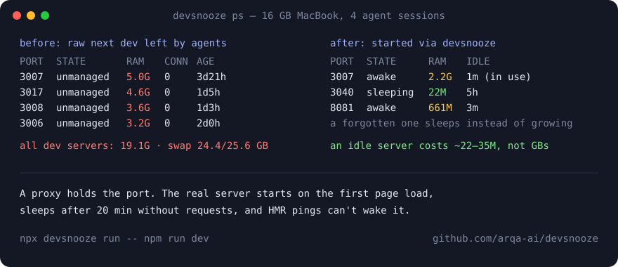

# devsnooze

**Dev servers that sleep when nobody looks at them.**

[](https://github.com/arqa-ai/devsnooze/actions/workflows/test.yml)
[](https://www.npmjs.com/package/devsnooze)


AI coding agents (Claude Code, Codex, Cursor) start `next dev`, `vite`, `uvicorn --reload` to check
their work — and leave them running. A few sessions in parallel worktrees and your laptop is swapping
by lunch: each forgotten `next dev` grows to 3–5 GB.



## Quick start

**Claude Code** — the plugin makes every session start dev servers the snoozable way:

```
/plugin marketplace add arqa-ai/devsnooze
/plugin install devsnooze@devsnooze
```

Restart your sessions (`claude --resume`) so they pick up the hook.

**Anything else** — wrap the command:

```sh
npx -y devsnooze run -- npm run dev
npx -y devsnooze ps          # what's running, who owns it, real RAM
```

## Why

Measured on a 16 GB MacBook with four agent sessions: four `next dev` processes held 3.2–5.0 GB each,
none had a browser connected, the oldest had been running for almost four days, and swap was
24.4 of 25.6 GB.

Process cleaners such as zclean, cc-reaper, proc-janitor and devclean are built around **orphans**
(parent process gone). Every one of these servers still had a live parent — an agent session left open
for days — so orphan-based cleanup doesn't apply.

A dev server isn't wrong to exist. It's wrong to stay **awake while nobody uses it**.

## How it works

```
devsnooze run -- npm run dev -- -p 3007
```

- A small proxy (~40 MB measured) holds port 3007. The real dev server starts **on the first HTTP request**.
- After 20 minutes without requests it is stopped (whole process group). The port stays open;
  the next page load wakes it again.
- Only real HTTP requests count as use. HMR pings (`/_next/webpack-hmr`, `/__vite_ping`, …) and
  WebSockets never keep it awake **and never wake it up** — a forgotten background tab that keeps
  reconnecting its HMR socket can't restart a sleeping server. Reloading the page does.
- If the server bloats past 4 GB, it's restarted fresh at the next quiet minute (60 s without requests),
  never in the middle of your work.
- HTTP and WebSocket (HMR) are proxied transparently while awake.

Live run on a real Next.js 15 app (one page compiled):

| | RAM |
|---|---|
| awake, one page compiled | 2.0 GB |
| asleep (proxy only) | 42 MB |
| wake-up on next request | ~12 s (cold compile) |

## Install

```sh
npx -y devsnooze --help          # no install
npm i -g devsnooze               # or globally
npx -y github:arqa-ai/devsnooze  # straight from GitHub
```

Node ≥ 18, macOS or Linux (`lsof` required), zero dependencies.

## Usage

```sh
devsnooze run [options] -- <command...>
  -p, --port N         public port (default: the command's -p/--port, $PORT, or 3000)
  --idle 20m           stop after this long without requests
  --max-mem 4g         restart at the next quiet minute once bigger than this (0 = off)
  --boot-timeout 120s

devsnooze ps [--json]                 every dev server on the machine: owner, real RAM, connections
devsnooze reap [--yes] [--min-age 1h] stop forgotten unmanaged servers (dry run without --yes)
devsnooze stop --port N | --session ID | --all
```

How the real server gets its port: `{port}` in the command is replaced (quote it — `'{port}'` — zsh and
bash drop an unquoted `{port}` that sits right before a redirect); otherwise a `-p N` /
`--port N` / `--port=N` argument is rewritten; `PORT` is always set in the environment.

```sh
devsnooze run -- next dev --turbopack -p 3007
devsnooze run -p 8000 -- uvicorn app:app --reload --port '{port}'
devsnooze run -p 5173 -- vite --port '{port}'
```

`ps` reports macOS `phys_footprint` (what Activity Monitor shows), not RSS — RSS misses compressed
and swapped memory, which is exactly where a bloated dev server lives when RAM is tight (RSS said
26 MB for a 5 GB server). OWNER walks the parent chain to the Claude Code session
(`~/.claude/sessions`), Codex, Cursor, or a terminal.

`reap` only proposes servers that are unmanaged, have 0 connections, are older than `--min-age`,
whose Claude session isn't busy, and that don't look like MCP servers. It never signals itself, its own
parents, or pid 1; if a server's parent also runs unrelated processes (a supervisor like pm2), only the
server's own subtree is stopped; each pid is re-checked right before every signal. Still: `ps` treats
any listening node/python/ruby/php/bun/deno process started from a project as a dev server, so a
Jupyter or a local model server can show up — that's why `reap` is a dry run until you pass `--yes`.

## Limits

- The proxy listens on all interfaces, like dev servers do by default — anyone on your network who can
  reach the port can wake the server.
- If a script hardcodes its port (`"dev": "next dev -p 3000"`) and the tool ignores `$PORT`, put
  `'{port}'` in the command yourself; devsnooze reports a boot timeout with this hint otherwise.
- The first request after sleep pays the cold start (Next.js: ~10–15 s to compile a page).
- Tested on macOS (real use) and Linux (CI). On Linux memory is RSS; macOS uses phys_footprint.

## Claude Code plugin

- **PreToolUse hook**: when Claude runs `next dev`, `vite`, `npm|pnpm|yarn|bun run dev`, `nuxt|astro dev`,
  `uvicorn --reload`, `flask run`, `rails s` or `manage.py runserver`, the call is denied with the exact
  devsnooze-wrapped command (with the right port flag for that tool), and Claude reruns it that way.
  It's a guard rail for the common forms, not a sandbox: `sh -c '…'`, `pnpm --filter x dev`,
  `npm start` and the like pass through. `DEVSNOOZE_HOOK=warn` makes it a hint, `off` disables it.
- **SessionEnd hook**: when a session ends (not on `/clear`), the dev servers it started are stopped —
  managed and unmanaged.
- **/devps**: what's running, who owns it, how much RAM.

## Other agents

Paste [docs/agents-snippet.md](docs/agents-snippet.md) into `AGENTS.md`, `CLAUDE.md` or `.cursorrules`.

## License

MIT
